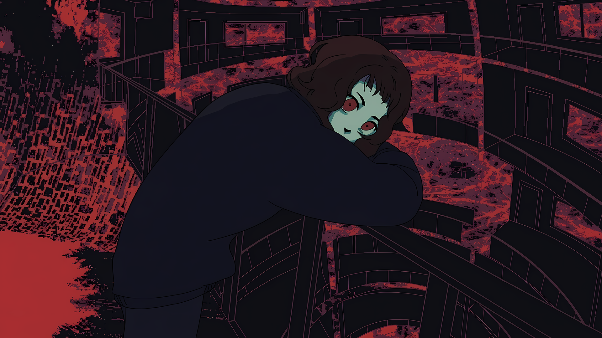
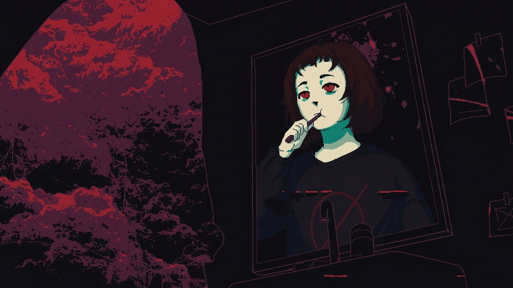
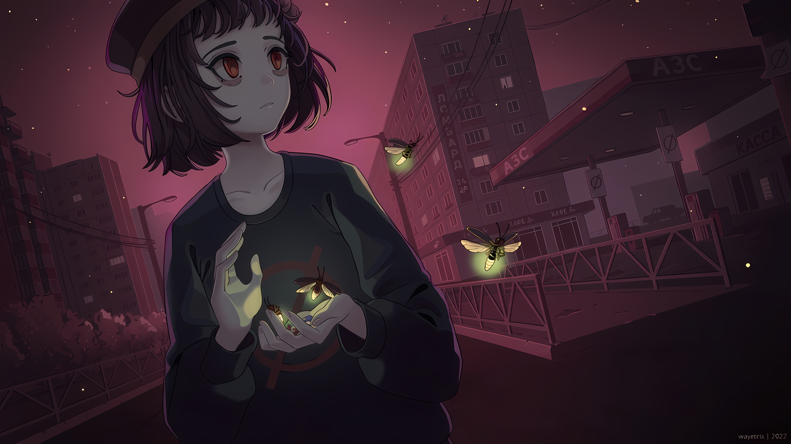
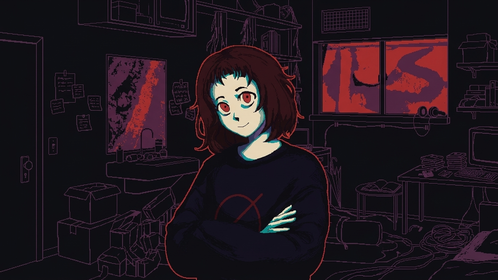
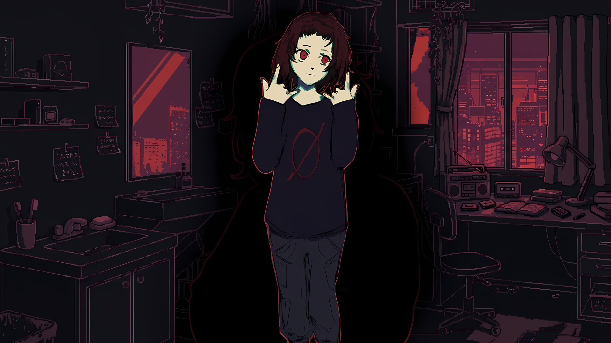
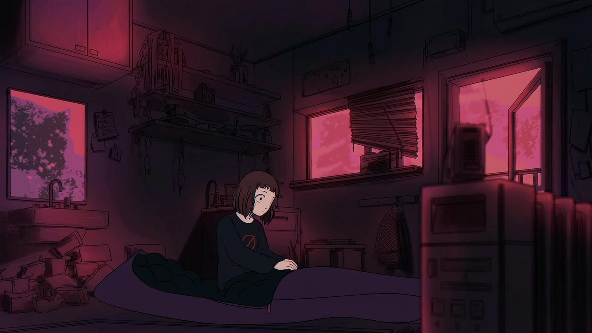
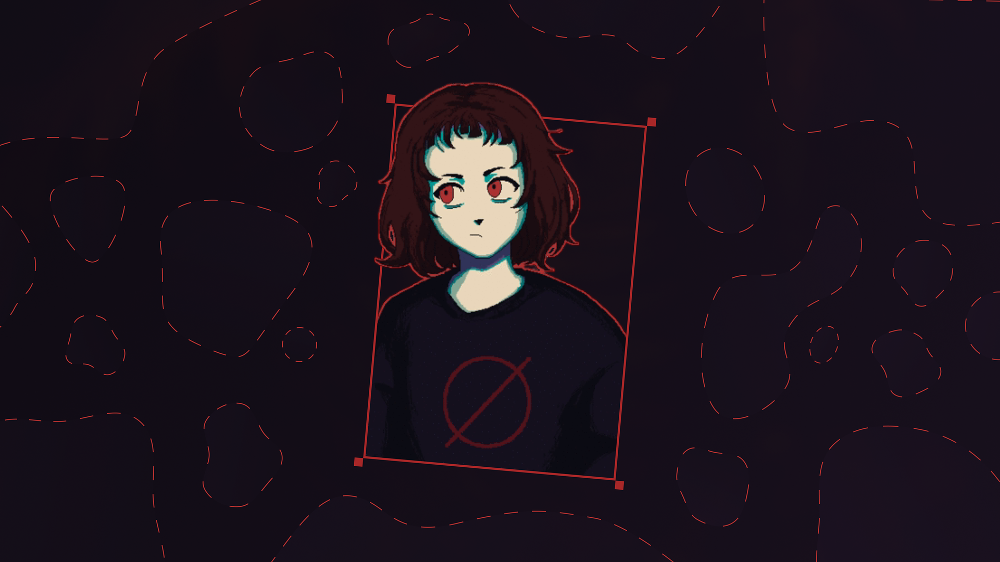
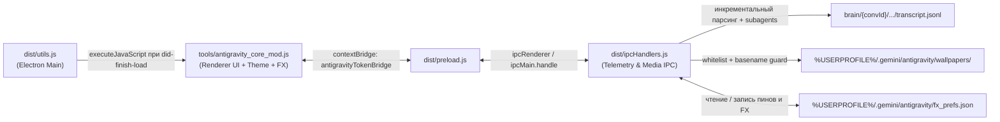

<div align="center">



<br />

# 🩸 Antigravity Milk UI Mod

**Obsidian-Crimson тема, движок живых обоев, real-time телеметрия токенов, инспектор контекста и карта роя субагентов для Google Antigravity IDE**

<p>
  
  
  
  
</p>

<p>
  <a href="#-что-нового">Что нового</a> •
  <a href="#-возможности">Возможности</a> •
  <a href="#-галерея-обоев">Галерея обоев</a> •
  <a href="#-быстрая-установка">Быстрая установка</a> •
  <a href="#-инструкция-и-спецификация-для-ии-агента">Для ИИ-агента</a>
</p>

</div>

---

## ✨ Что нового

> [!NOTE]
> Актуальная версия полностью совместима с **Antigravity v2.33.0+** (`Electron 44.9+`) и переработана с фокусом на читаемость, доступность и чистый Obsidian-Crimson дизайн без лишнего визуального шума.

- **Совместимость с Antigravity v2.33.0+:** загрузчик в `dist/utils.js` поддерживает `hubContents || win?.webContents`, а инъекция IPC в `dist/ipcHandlers.js` корректно встраивается до финального `return { ... }` внутри `registerIpcHandlers`.
- **Полное оформление оболочки IDE:** единая палитра распространяется на левый сайдбар (цельная 1px рамка активного чата, очистка фона hover-кнопок), верхний тулбар, плавающую панель **Overview** справа (включая `.animate-overview-panel`, Shadow DOM и счётчики `Subagents` / `Background Tasks`), нативные оверлеи (`[role="tooltip"]`, `.monaco-hover`, `.quick-input-widget`, диалоги) и стандартные тонкие скроллбары (`scrollbar-width: thin`).
- **2 пилюли в правом нижнем доке без hover-ловушки:** в углу экрана только **Рой** и счётчик сцен (`12/12`). Убрано случайное всплытие меню при наведении — **ЛКМ** (или `Enter` / `Пробел`) открывает 2-вкладочное меню (**`Сцены`** | **`Вид и FX`**), а **ПКМ** перелистывает на следующую сцену (или подсказывает, что сцена закреплена).
- **Чистый экран Home и настройка приветствия:** на новом пустом экране убран шум из нулей — показывается компактный статус `Монитор: новый чат`, а заголовок приветствия оформлен в виде строгой VN/CRT-плашки с выбором позиции (`Выше` / `Центр` / `Ниже` / `Скрыть`).
- **Доступность, производительность и векторная графика:** семантическая кнопка-индикатор контекста `<button>`, 2-строчный перенос задач на карточках графа роя, управление узлами с клавиатуры (`Enter` / стрелки / focus-trap + возврат фокуса по `Esc`), Pointer Events для панорамирования, поддержка `prefers-reduced-motion` (в CSS и Canvas/CRT/VHS FX), `tabular-nums`, векторные SVG-иконки вместо эмодзи и сохранение настроек в `%USERPROFILE%\.gemini\antigravity\fx_prefs.json`.

---

## 🎨 Возможности

| 🎨 Визуал, обои и атмосфера | 📊 Панель телеметрии, инспектор и граф роя |
|---|---|
| **12 встроенных Full HD сцен:** фото и видео-обои (`.png`, `.jpg`, `.webp`, `.gif`, `.mp4`, `.webm`) из `%USERPROFILE%\.gemini\antigravity\wallpapers` с кешем предпросмотра (`` + `<video>`) | **Телеметрия в реальном времени:** `turns`, `steps`, скорость `tok/s` (медиана + спарклайн по шагам), активное время ИИ и табличное выравнивание цифр (`tabular-nums`) |
| **Фиксированная палитра Milk Obsidian-Crimson:** все рамки, оверлеи, скроллбары, выделение текста и 240 пиксельных частиц выдержаны в единой багрово-кремовой гамме (`#c6343c` / `#f8e0c0`) | **Контекст и кэш:** текущий объём (`Input + Cache`), `Cache Hit %` за шаг и сессию, общий прогон токенов и кнопка-кольцо заполнения окна `1M` |
| **Раздельные пины и нормализованный `0–100%` scrim:** независимое закрепление обоев для `Home` и `Чат` с хранением в `fx_prefs.json`, авторотация (выключена по умолчанию), плавный параллакс камеры, спотлайт, CRT-сканлайны и VHS-переключение | **Расчёт API + Инспектор контекста:** разбивка стоимости `Input / Cache / Output` по чату и субагентам, список частых инструментов и файлов с подсветкой повторных чтений |
| **Чистые таблицы и диалоги:** карточки сообщений со сглаженным фоном и автоматическое удержание широких Markdown-таблиц и блоков кода строго внутри колонки чата (`constrainTablesInDialogBox`) | **Интерактивное SVG-дерево роя:** иерархия вызовов `invoke_subagent`, 2-строчные карточки с задачами и последним инструментом, резкий SVG-зум, Pointer Events перетаскивание и навигация с клавиатуры |

> **Поддержка моделей:** в прайсинге и детекторе поддержаны **Gemini 3.8 Flash**, **Gemini 4 Hydrogen**, **Gemini 4 Argon** и **Gemini 4 Carbon** (контекстное окно `1M`, распознавание триггера выбора модели игнорирует прикреплённые файлы). При необходимости расширьте `modelPattern` и `__resolveModelPricing` по инструкции ниже.

---

## 🖼 Галерея обоев

В репозитории собраны **12 готовых Full HD сцен** (`11 × 1920×1080 PNG` + `1 × 1920×1080 MP4`), прошедших ремастеринг, 16:9 outpainting и апскейлинг **Real-ESRGAN x4plus-anime** (для сцен `02–10` и `12`). Свои изображения и видео можно докинуть в `%USERPROFILE%\.gemini\antigravity\wallpapers` кнопкой **Открыть папку обоев** во вкладке `Вид и FX`.

| 01 · Комната (Pixel Art FHD) | 02 · У зеркала (Щётка) | 03 · Взгляд в зеркало |
| :---: | :---: | :---: |
| <br /><sub>`01_milk_room.png`</sub> | <br /><sub>`02_milk_mirror_brush.png`</sub> | <br /><sub>`03_milk_mirror_look.png`</sub> |

| 04 · Балкон (Ночной город) | 05 · На полу | 06 · Заправка и светлячки |
| :---: | :---: | :---: |
| <br /><sub>`04_milk_balcony.png`</sub> | <br /><sub>`05_milk_floor.png`</sub> | <br /><sub>`06_milk_azs_fireflies.png`</sub> |

| 07 · Комната (Крупный план) | 08 · Комната (В полный рост) | 09 · Спальник |
| :---: | :---: | :---: |
| <br /><sub>`07_milk_chan_room.png`</sub> | <br /><sub>`08_milk_fullbody_room.png`</sub> | <br /><sub>`09_milk_sleepingbag.png`</sub> |

| 10 · Спираль (Mosquito) | 11 · Портретная рамка | 12 · Анимированная комната (MP4 Loop) |
| :---: | :---: | :---: |
| <br /><sub>`10_milk_mosquito.png`</sub> | <br /><sub>`11_milk_portrait_frame.png`</sub> | <a href="./wallpapers/12_milk_room_blink.mp4"></a><br /><sub>🎬 <a href="./wallpapers/12_milk_room_blink.mp4"><b>12_milk_room_blink.mp4</b></a> · 1920×1080 Loop</sub> |

---

## ⚡ Быстрая установка

### Требования
- **Windows 10 / 11**
- Установленный **Antigravity** (протестировано вплоть до **v2.33.0**) в `%LOCALAPPDATA%\Programs\Antigravity`
- **Node.js** (LTS, команды `node` и `npx` доступны в `PATH`)

### Установка в 2 шага
1. Клонируйте репозиторий:
   ```powershell
   git clone https://github.com/Aldiyuar/antigravity-milk-ui-mod.git
   cd antigravity-milk-ui-mod
   ```
2. Запустите установщик:
   ```powershell
   powershell -ExecutionPolicy Bypass -File .\install.ps1
   ```
   Скрипт скопирует модули и обои в `%USERPROFILE%\.gemini\antigravity\{tools,wallpapers}`, поместит `Apply_AG_UI_Mods.bat` на **Рабочий стол**, создаст резервную копию `app.asar.bak` и пропатчит `app.asar`.

### Команды `Apply_AG_UI_Mods.bat`
| Команда | Что делает |
|---|---|
| `Apply_AG_UI_Mods.bat` | Закрывает Antigravity, ставит или быстро применяет кэш-патч и запускает IDE |
| `Apply_AG_UI_Mods.bat -Rebuild` | Принудительно пересобирает кэш `app.asar.patched` (нужно после обновления Antigravity) |
| `Apply_AG_UI_Mods.bat -BuildOnly` | Собирает `app.asar.patched` без закрытия и перезапуска работающего Antigravity |
| `Apply_AG_UI_Mods.bat -Restore` | Полностью откатывает интерфейс к оригинальному `app.asar.bak` |

---

## 🤖 Инструкция и спецификация для ИИ-агента

Если вы хотите, чтобы ваш ИИ-агент автоматически установил, обновил или адаптировал мод под новую версию Antigravity:

```text
Изучи README.md из https://github.com/Aldiyuar/antigravity-milk-ui-mod и примени этот UI-мод к моему локальному Antigravity. Перед заменой app.asar проверь пути, прогони синтаксис-проверку node --check для tools/antigravity_core_mod.js и тест сборки через -BuildOnly, после чего подскажи, как перезапустить Antigravity для активации.
```

<details>
<summary><b>Техническая спецификация: архитектура, точки патча (v2.33+) и адаптация</b></summary>

### 1. Схема взаимодействия модулей



### 2. Файлы проекта
- `tools/antigravity_core_mod.js` — клиентский модуль для Electron Renderer: DOM-наблюдение, панель телеметрии (`#antigravity-token-stats-bar`), поповер «Монитор сессии» (Обзор + Инспектор), SVG-граф роя (`#antigravity-swarm-modal`), 2-пилюльный док (`#antigravity-corner-dock`), 2-вкладочное меню обоев (`#antigravity-wallpaper-menu`), движок сцен/FX, тема сайдбара/Overview/тултипов и защита ширины таблиц.
- `tools/update_antigravity_mods.ps1` — распаковывает `app.asar` через `npx --yes @electron/asar`, идемпотентно патчит 3 файла в `dist/` с маркерами `BEGIN`/`END`, проверяет синтаксис через `node --check`, собирает кэш `app.asar.patched` + `app.asar.patched.unpacked` + `.ver`.
- `tools/restart_and_apply.ps1` — быстрая установка собранного `app.asar.patched` и перезапуск IDE.
- `Apply_AG_UI_Mods.bat` — Windows-обёртка с UAC-элевацией и пробросом `-BuildOnly` / `-Rebuild` / `-Restore`.
- `install.ps1` — раскладывает скрипты, обои и ярлык установки.

### 3. Точки интеграции внутри `app.asar` (`Antigravity v2.33.0+`)
1. **`dist/utils.js`** (`// Antigravity Core Mod Loader BEGIN` ... `END`):
   - Вставляется сразу после `(0, loadingOverlay_1.attachLoadingOverlay)(win, foregroundColor, backgroundColor);`.
   - Использует `const __agyTargetWc = (typeof hubContents !== 'undefined' && hubContents) ? hubContents : win?.webContents;` (совместимо с архитектурой `v2.33+`, где за окно чата отвечает `hubContents`).
   - Читает `%USERPROFILE%\.gemini\antigravity\tools\antigravity_core_mod.js` с диска при каждом `did-finish-load` — изменения UI-скрипта применяются через обычный `Developer: Reload Window` без пересборки `app.asar`.
2. **`dist/preload.js`** (`// Antigravity Token Bridge BEGIN` ... `END`):
   - Пробрасывает `window.antigravityTokenBridge` через `contextBridge.exposeInMainWorld`:
     - `getStats(convId, modelName)` → `antigravity:get-token-stats`
     - `listWallpapers()` → `antigravity:list-wallpapers`
     - `readWallpaper(fileName)` → `antigravity:read-wallpaper`
     - `openWallpapersDir()` → `antigravity:open-wallpapers-dir`
     - `getFxPrefs()` → `antigravity:get-fx-prefs`
     - `setFxPrefs(prefs)` → `antigravity:set-fx-prefs`
3. **`dist/ipcHandlers.js`** (`// Antigravity Token Stats IPC Handler BEGIN` ... `END`):
   - Вставляется внутри `registerIpcHandlers` **перед финальным `return { ... }`** (иначе обработчики после `return` остаются недостижимыми в `v2.33.0+`).
   - Инкрементально (по `byteOffset` + `__tokenStatsCache`) читает `transcript.jsonl` основного чата и дочерних субагентов, отслеживает `antigravity:get-fx-prefs` / `set-fx-prefs` и защищает чтение обоев/чатов от path traversal.

### 4. Чеклист адаптации
- **Права администратора:** при желании запускать IDE без прав админа уберите `-Verb RunAs` из `Apply_AG_UI_Mods.bat` и `update_antigravity_mods.ps1` (`%LOCALAPPDATA%` доступен на запись текущему пользователю).
- **Новые модели:** добавьте паттерн в `modelPattern` (`tools/antigravity_core_mod.js`) и ветки в `__resolveModelLimit` / `__resolveModelPricing` (`tools/update_antigravity_mods.ps1`).
- **Откат:** `Apply_AG_UI_Mods.bat -Restore` восстанавливает стоковый `app.asar.bak`.

</details>
