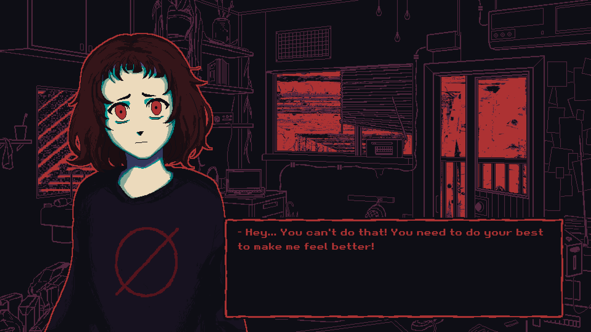
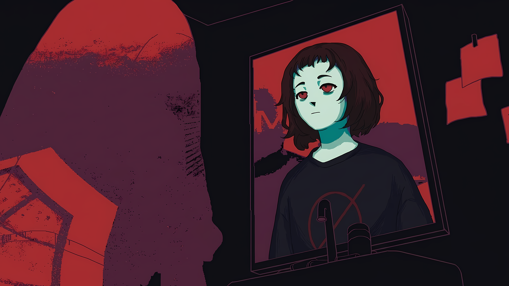
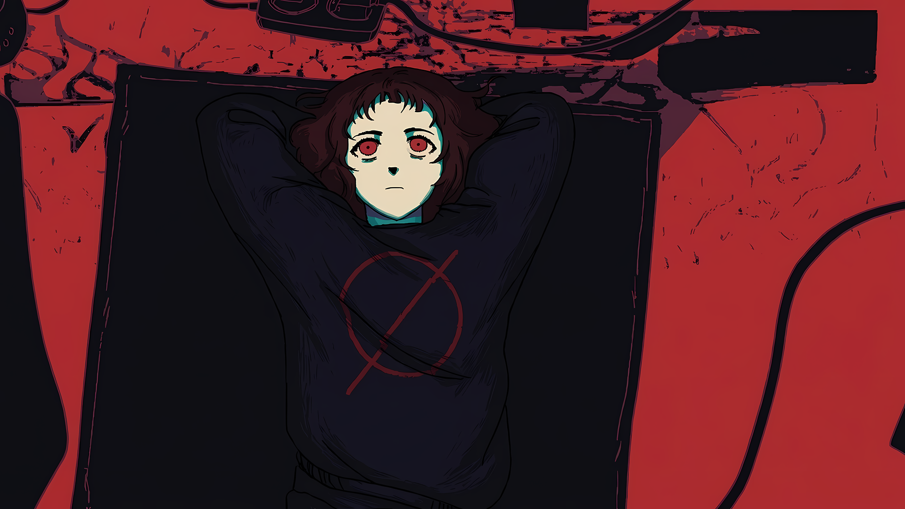

<div align="center">


# 🩸 Antigravity Milk UI Mod

**Атмосферная тема, движок живых обоев и real-time телеметрия токенов, скорости и роя субагентов для Google Antigravity IDE**


[✨ Возможности](#-возможности) • [🖼 Галерея обоев](#-галерея-обоев) • [⚡ Быстрая установка](#-быстрая-установка) • [🤖 Инструкция для ИИ-агента](#-инструкция-для-ии-агента)

</div>

---

## ✨ Возможности

| 🎨 Визуал и движок обоев | 📊 Панель телеметрии и роя |
|---|---|
| **Фото и видео-обои** (`.png`, `.jpg`, `.webp`, `.gif`, `.mp4`, `.webm`) из `%USERPROFILE%\.gemini\antigravity\wallpapers` | **Метрики в реальном времени:** `turns`, `steps`, скорость `tok/s` (медиана + спарклайн) и активное время работы ИИ |
| **Авто-палитра из обоев:** цвета акцента, свечения, частиц, скроллбара и рамки автоматически подстраиваются под картинку | **Контекст и кэш:** текущий контекст (`Input + Cache`), Cache Hit %, общий оборот токенов за сессию и `%` от окна `1M` |
| **Раздельные пины и эффекты:** отдельные обои для `Home` и `Чат`, авторотация, слайдер затемнения, 240 пиксельных частиц, параллакс камеры, спотлайт за курсором, CRT-сканлайны и VHS-переключение | **Стоимость API:** подробная разбивка `Input / Cache / Output` отдельно по основному чату и субагентам |
| **Стеклянный UI + ровные таблицы:** карточки сообщений и инпута с пульсацией при генерации ИИ, плюс удержание широких Markdown-таблиц строго внутри рамки чата | **Инспектор контекста и карта роя:** топ инструментов, список прочитанных/изменённых файлов и интерактивное SVG-дерево субагентов `invoke_subagent` |

> **Поддержка моделей:** в текущей сборке оставлены **Gemini 3.8 Flash**, **Gemini 4 Hydrogen**, **Gemini 4 Argon** и **Gemini 4 Carbon** (окно `1M`). Если вам нужны другие модели (Claude, GPT и т.д.), попросите ИИ-агента расширить `modelPattern` и `__resolveModelPricing` по секции ниже.

---

## 🖼 Галерея обоев

В комплекте уже лежат 5 обоев в папке [`wallpapers/`](./wallpapers) — свои можно докинуть туда же в любой момент (кнопка открытия папки встроена прямо в меню обоев справа внизу).

<details>
<summary><b>Показать все 5 встроенных обоев</b></summary>
<br />

| `01_milk_room.png` | `02_milk_mirror_brush.png` | `03_milk_mirror_look.png` |
| :---: | :---: | :---: |
|  |  |  |

| `04_milk_balcony.png` | `05_milk_floor.png` |
| :---: | :---: |
|  |  |

</details>

---

## ⚡ Быстрая установка

### Требования
- **Windows 10 / 11**
- Установленный **Antigravity** в `%LOCALAPPDATA%\Programs\Antigravity`
- **Node.js** (LTS, команды `node` и `npx` должны быть доступны в `PATH`)

### Установка в 2 шага
1. Клонируйте репозиторий:
   ```powershell
   git clone https://github.com/Aldiyuar/antigravity-milk-ui-mod.git
   cd antigravity-milk-ui-mod
   ```
2. Запустите установщик:
   ```powershell
   powershell -ExecutionPolicy Bypass -File .\install.ps1
   ```
   Скрипт разложит файлы в `%USERPROFILE%\.gemini\antigravity\{tools,wallpapers}`, положит `Apply_AG_UI_Mods.bat` на **Рабочий стол**, создаст резервную копию `app.asar.bak` и пропатчит `app.asar`.

### Команды `Apply_AG_UI_Mods.bat`
| Команда | Что делает |
|---|---|
| `Apply_AG_UI_Mods.bat` | Закрывает Antigravity, ставит/обновляет патч и запускает IDE |
| `Apply_AG_UI_Mods.bat -Rebuild` | Принудительно пересобирает кэш `app.asar.patched` |
| `Apply_AG_UI_Mods.bat -BuildOnly` | Собирает `app.asar.patched` без закрытия Antigravity |
| `Apply_AG_UI_Mods.bat -Restore` | Полностью откатывает интерфейс к оригинальному `app.asar.bak` |

---

## 🤖 Инструкция для ИИ-агента

Если вы хотите, чтобы ваш ИИ-агент сам установил или адаптировал этот дизайн на чистом Antigravity, просто отправьте ему этот промпт:

```text
Изучи README.md из https://github.com/Aldiyuar/antigravity-milk-ui-mod и примени этот UI-мод (обои, тему и нижнюю панель телеметрии) к моему локальному Antigravity. Перед заменой app.asar проверь пути, прогони синтаксис-проверку node --check и сборку с -BuildOnly, после чего объясни мне, как перезапустить Antigravity для активации.
```

<details>
<summary><b>Техническая спецификация для ИИ-агента (архитектура, точки патча и адаптация)</b></summary>

### 1. Файлы проекта
- `tools/antigravity_core_mod.js` — клиентский скрипт для renderer-окна Electron (DOM-наблюдение, панель токенов, поповер с инспектором контекста, SVG-карта роя, движок обоев/FX, CSS `#antigravity-milk-style`, удержание таблиц `constrainTablesInDialogBox`).
- `tools/update_antigravity_mods.ps1` — распаковывает `%LOCALAPPDATA%\Programs\Antigravity\resources\app.asar` через `npx --yes @electron/asar`, идемпотентно патчит 3 файла в `dist/` с комментариями-маркерами `BEGIN`/`END`, проверяет синтаксис через `node`, пакует обратно с `--unpack "**/node_modules/chrome-devtools-mcp/**"` и сохраняет кэш `app.asar.patched` + `app.asar.patched.unpacked` + `.ver`.
- `tools/restart_and_apply.ps1` — быстрая установка уже собранного `app.asar.patched` (и `.unpacked`) с перезапуском приложения.
- `Apply_AG_UI_Mods.bat` — Windows-обёртка с UAC-элевацией, проверкой `node --check` и нормализацией флагов `-BuildOnly` / `-Rebuild` / `-Restore`.
- `install.ps1` — копирует скрипты и обои в `%USERPROFILE%\.gemini\antigravity\` и `Apply_AG_UI_Mods.bat` на Рабочий стол.

### 2. Точки интеграции внутри `app.asar`
Если в будущей версии Antigravity структура `dist/` изменится, проверьте эти 3 патча:

1. **`dist/utils.js`** (маркеры `// Antigravity Core Mod Loader BEGIN` ... `END`):
   - Вставляется сразу после `(0, loadingOverlay_1.attachLoadingOverlay)(win, foregroundColor, backgroundColor);`.
   - Вешает `win.webContents.on('did-finish-load', ...)` и выполняет `fs.readFileSync(<homedir>/.gemini/antigravity/tools/antigravity_core_mod.js, 'utf8')` через `win.webContents.executeJavaScript(modCode)`.
   - Изменения в `antigravity_core_mod.js` не требуют пересборки `app.asar` — достаточно перезагрузить окно.
2. **`dist/preload.js`** (маркеры `// Antigravity Token Bridge BEGIN` ... `END`):
   - Пробрасывает `window.antigravityTokenBridge` через `contextBridge.exposeInMainWorld` (используя `electron_1` с фоллбэком на `require('electron')`):
     - `getStats(convId, modelName)` → `antigravity:get-token-stats`
     - `listWallpapers()` → `antigravity:list-wallpapers`
     - `readWallpaper(fileName)` → `antigravity:read-wallpaper`
     - `openWallpapersDir()` → `antigravity:open-wallpapers-dir`
3. **`dist/ipcHandlers.js`** (маркеры `// Antigravity Token Stats IPC Handler BEGIN` ... `END`):
   - Вставляется в конец функции `registerIpcHandlers` (перед последней `}` до `//# sourceMappingURL`).
   - Инкрементально (по `byteOffset` и кэшу `__tokenStatsCache`) читает `%USERPROFILE%\.gemini\antigravity\brain\<convId>\.system_generated\logs\transcript.jsonl` и дочерние логи субагентов.
   - При изменении формата транскрипта обновите `__applyTranscriptLines`.

### 3. Чеклист адаптации на чистой машине
1. **Права администратора (опционально):** если пользователь не хочет запускать IDE от админа, уберите `-Verb RunAs` из `Apply_AG_UI_Mods.bat` и `update_antigravity_mods.ps1` (для записи в `%LOCALAPPDATA%` права админа не требуются, а отказ от `RunAs` сохранит drag-and-drop из Проводника).
2. **Другие модели:** расширьте `modelPattern` в `getActiveModelName` (`tools/antigravity_core_mod.js`) и функции `__resolveModelLimit` / `__resolveModelPricing` (`tools/update_antigravity_mods.ps1`).
3. **Безопасная проверка:** если агент работает внутри самого Antigravity, сначала выполните `install.ps1 -BuildOnly` (это не убьёт процесс IDE), проверьте сборку и попросите пользователя закрыть Antigravity и запустить `Apply_AG_UI_Mods.bat`.
4. **Откат:** `Apply_AG_UI_Mods.bat -Restore` восстанавливает `app.asar.bak`.

</details>
